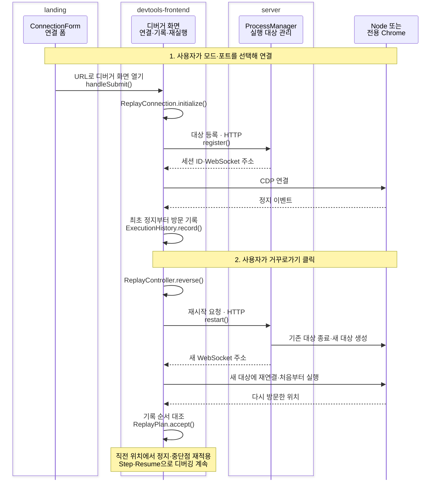

# BackDo

**지나친 실행 위치로 돌아가, 디버깅을 이어가는 JavaScript 디버거입니다.**

<p align="center">
  <a href="https://landing.backdo.site/">
    
  </a>
</p>

여러 함수와 모듈을 따라가다 확인하려던 코드를 지나쳤다면, BackDo의 거꾸로가기 버튼으로 이전 실행 위치를 다시 살펴볼 수 있습니다. Console에 입력한 JavaScript와 Node 프로그램을 지원합니다.

[시작하기](https://landing.backdo.site/) · [디버거 프론트엔드](https://github.com/hong7ya/backdo-devtools-frontend) · [로컬 서버](https://github.com/hong7ya/backdo-server) · [랜딩 페이지](https://github.com/hong7ya/backdo-landing)

## 시연


초기 버전에서 촬영한 시연입니다.

<details>
<summary>조건문·중첩 함수·콜백 함수 시연 더 보기</summary>


</details>

## 제작 배경과 주요 기능

디버깅하다 Step을 한 번 더 누르면, 지나친 위치를 찾기 위해 프로그램을 다시 실행하고 중단점을 옮기곤 합니다. **앞으로 이동하듯 이전 위치로도 돌아갈 수 있으면 좋겠다**는 생각에서 BackDo를 만들었습니다.

- **지나온 순서로 이동합니다.** 반복문에서 같은 줄을 여러 번 방문한 경우를 구분하고, 조건문에서는 실제로 실행한 분기를 따라갑니다.
- **함수와 모듈을 넘나듭니다.** 기록이 남아 있다면 실행을 마친 함수나 다른 모듈의 이전 위치로 돌아갑니다. 여러 함수를 거치는 CLI 로직이나 Console 재현 코드를 살펴볼 때 활용할 수 있습니다.
- **돌아온 뒤에도 디버깅을 계속합니다.** 같은 탭과 중단점 설정을 유지하며 Step·Resume으로 다음 실행을 탐색합니다.

## 시작하기

디버깅 화면은 웹에서 열고, 실행 대상을 관리할 서버는 내 컴퓨터에서 실행합니다. **Node.js 22.11.0**을 기준으로 합니다.

**1. 로컬 서버를 설치합니다.**

```sh
git clone https://github.com/hong7ya/backdo-server.git
cd backdo-server
npm ci
```

**2. 디버깅할 대상에 맞는 명령 하나를 실행합니다.**

| 대상    | 서버 저장소에서 실행    | 기본 디버깅 포트 | 준비할 코드                          |
| ------- | ----------------------- | ---------------- | ------------------------------------ |
| Console | `npm run start:console` | `9222`           | 연결 후 Console에 JavaScript 입력    |
| Node.js | `npm run start:node`    | `9229`           | 별도 터미널에서 사용자 프로그램 실행 |

Console 모드는 서버가 전용 Chrome을 준비합니다. Node 모드는 **별도 터미널의 사용자 프로젝트에서** 다음 명령도 실행합니다. `your-file.js`를 디버깅할 파일로 바꿉니다.

```sh
node --inspect-brk=127.0.0.1:9229 ./your-file.js
```

**3. [랜딩 페이지](https://landing.backdo.site/)에서 같은 모드를 선택하고, 터미널에 안내된 포트로 연결합니다.**

중단점이나 `debugger`에서 멈춘 뒤 Step·Resume으로 진행하고 거꾸로가기 버튼을 누릅니다. 돌아갈 수 있는 범위는 기록을 시작한 정지 이후입니다. 사용을 마치면 로컬 서버 터미널에서 `Ctrl+C`를 누릅니다.

## 저장소와 핵심 흐름

**랜딩은 연결을 안내하고, 프론트엔드는 실행을 기록하며, 서버는 실행 대상을 다시 시작합니다.**

| 저장소                                                                   | 담당 역할                                      | 주요 기술                          |
| ------------------------------------------------------------------------ | ---------------------------------------------- | ---------------------------------- |
| [landing](https://github.com/hong7ya/backdo-landing)                     | 모드별 준비 안내, 포트 입력, 디버거 화면 열기  | React, Vite, Tailwind CSS, daisyUI |
| [devtools-frontend](https://github.com/hong7ya/backdo-devtools-frontend) | 대상 연결, 방문 기록, 거꾸로가기와 후속 디버깅 | TypeScript, Chrome DevTools, CDP   |
| [server](https://github.com/hong7ya/backdo-server)                       | 실행 조건 보관, Node·전용 Chrome의 재시작      | Node.js, Express, Puppeteer        |

아래는 준비된 대상에 연결한 뒤 거꾸로가는 흐름입니다. 핵심 함수와 저장소 경계만 표시하고, 중간 HTTP 처리와 내부 호출은 생략했습니다. CDP는 디버거와 실행 대상이 명령·이벤트를 주고받는 통신 규약입니다.



## 거꾸로가기의 원리

**실제로 방문한 위치를 기록하고, 실행 대상을 새로 시작해 직전 위치까지 다시 실행합니다.** 반복문에서 같은 줄을 여러 번 지나도 각각의 방문을 구분합니다.

Node는 보관한 인자·환경변수·작업 폴더 등 실행 조건으로 다시 실행합니다. Console은 기록한 입력을 같은 순서와 실행 위치에서 다시 제출합니다. 프로세스를 새로 만들면서 함수 밖의 변수와 모듈 상태도 다시 구성합니다. BackDo 화면과 로컬 서버는 계속 실행됩니다.

프론트엔드는 최초 기록 위치부터 목표까지 소스와 방문 순서를 대조합니다. 경로가 달라지면 이동을 중단하고, 목표에 도착하면 그 이후 기록을 버린 뒤 새로 진행한 경로를 기록합니다. 변수 값은 다시 실행하면서 계산합니다.

### 기록량은 CDP 통신 비용으로 제한합니다

기록이 늘면 다시 실행할 때 처리할 위치도 늘어납니다. 사용자 코드와 분리된 프로세스에서 **CDP 요청 한 번의 왕복 시간**을 측정하고 다음 기준을 적용합니다.

```text
예상 CDP 처리 시간 = 측정한 왕복 시간 × 방문 기록 수
기록 유지 조건 = 예상 CDP 처리 시간 < 3초
```

3초는 CDP 통신에 배정한 예산입니다. 코드 계산·대기·프로세스 시작 시간까지 포함한 복원 완료 시간을 보장하지는 않습니다. 한도에 도달하면 전체 기록을 해제하며, 일반 디버깅은 계속할 수 있습니다. 거꾸로가기로 버린 미래 기록만큼 예상 비용도 줄어듭니다.

## 확인한 범위와 한계

| 구분           | 범위                                                                                                                                                 |
| -------------- | ---------------------------------------------------------------------------------------------------------------------------------------------------- |
| 검증 예제 있음 | 반복문·분기·`break`, 간단한 `async/await`, 완료된 함수·Console 코드, Node의 CJS·ESM과 `import`·`import()` 모듈 이동, 복원 후 Step·Resume·중단점 유지 |
| 추가 검증 필요 | 여러 비동기 작업의 실행 순서, 비동기 경계를 지나는 Step, 다양한 Node 실행 옵션 조합                                                                  |
| 지원하지 않음  | Worker·여러 프로세스의 동시 되돌리기, 터미널 입력을 기다리는 프로그램, 서버나 탭을 다시 연 뒤 이전 기록 복구                                         |

- **파일·DB 등 외부 상태는 과거로 되돌리지 않습니다.** 재실행 중 요청·로그·파일 쓰기가 반복될 수 있고, 시간·난수·외부 응답이 달라지면 계산 결과도 달라질 수 있습니다.
- **기록은 현재 세션에서만 유지됩니다.** 새로고침·종료·기록 한도 도달이나 중단점 전체 비활성화로 기록이 해제될 수 있습니다. 정지 중 수동으로 바꾼 값과 열린 파일·소켓도 복구하지 않습니다.
